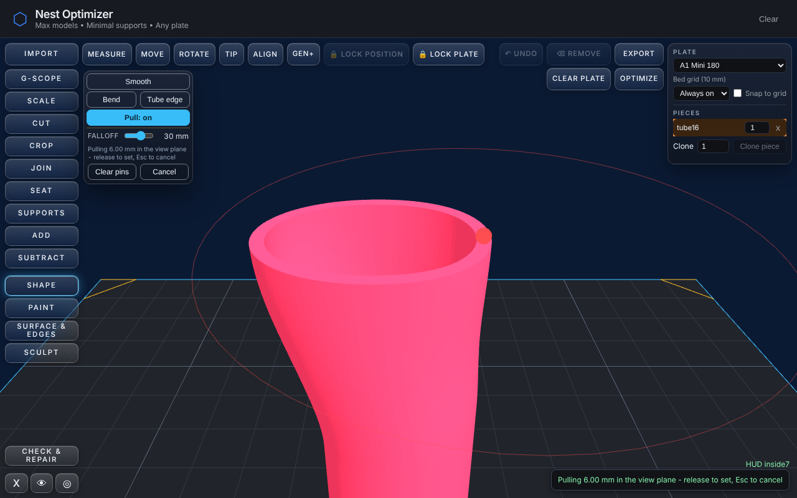

# Pull - grab a spot on a piece and drag it

`nso_densify.js` (the shared subdivision), `nso_pull.js` (the field and its
guards, headless) and `app-pull.js` (the pointer session), under **Shape -> Pull**.

```
node tools/nso_pull_test.js          headless: densify, field, pins, tube, box, guards (58 checks)
node tools/nso_pull_drive_check.js   the real app at 1280x800: gesture, pins, Shift, Escape, refusals
PULL_SHOTS=dir node tools/nso_pull_drive_check.js     also writes the screenshot
```

Both are in `npm test` (`pull:test`, `pull:drive`).



*Mid-drag: a Stock tube D20 wall 1.6, a 30 mm pin on the right-hand lip (the red
anchor, with its radius), the left-hand lip grabbed and pulled 6 mm outward in the view
plane. The mesh on screen is the real one, live.*

## The gesture

| | |
|---|---|
| **Arm** | select a piece, press **Pull**. The panel's slider *is* the Brush's size slider (the two are mirrored): the falloff radius, 1-50 mm, 12 by default. |
| **Click** | a plain click on the piece drops a **pin**: a spot that holds still. It is drawn as a small red anchor with its radius, keeps the radius the slider had when it was placed, and stays until **Clear pins** or until Pull is left. |
| **Drag** | press-and-drag a spot to **grab** it. After 4 px the triangles under the grab are densified (below) and the real mesh follows the cursor, live, in the **view plane** - the plane through the grab, square to the camera. **Shift** moves it **along the surface normal** at the grab, in or out. |
| **Release** | is Set. One Undo step. There is no Set button. |
| **Escape** | mid-drag puts the piece back. **Cancel** does the same and leaves the tool. |

The preview is not a commit: while dragging the placed mesh shows a throwaway
geometry and `m.rawTris` is untouched; a refused, cancelled or lost pull ends by
putting the original geometry back.

## The field

A pull has a grab (a point, a radius, a displacement **D**) and any number of pins
(a point and a radius each). Every vertex within the grab's radius moves by

```
D * phi(v)         phi = g(v) * s(v)
g  = bell(d_grab / r_grab)             bell(t) = u*u*(3 - 2u), u = 1 - t     1 at the centre, 0 at the radius, flat at both ends
s  = product over pins of ( 1 - bell(d_pin / r_pin) * q ),   q = w_pin / (w_pin + w_grab),   w = 1 / (d^4 + 0.05^4)
```

A pin holds by *its own* bell, weighted by how much nearer it is than the grab. So
**the nearest handle wins where the radii overlap - and wins smoothly**: at a pin's
vertex `s = 0` (it does not move); at the grab's vertex `s = 1` (it follows the
cursor exactly, even with a pin's radius over it); in between they blend, with no
step where "nearest" changes hands (a hard winner-takes-all would leave a cliff
there; the test scans for it). `phi` depends only on where the vertices were and
where the handles are, never on D, so it is worked out once and every mouse move
after that is `base + D * phi`.

The grab (always) and a pin (when a vertex is within 0.6 mm) **snap to the nearest
vertex** of the densified mesh, so "the lip moved 6 mm at the grab" and "the pinned
vertex did not move" are statements about a vertex.

Measured, headless, on the Stock tube D20 wall 1.6 (`tools/nso_pull_test.js`):
the grab vertex moves 6.000 mm; every vertex moves by exactly `6 x bell(d)` (worst
error 4e-15 mm over 60,000 vertices); 0 at and beyond the radius (2,467 vertices, none
moved; the tube's far end is bit-for-bit where it was). With a 30 mm pin on the
other lip: the pinned vertex moves 0 mm, everything within 1 mm of it at most 0.007 mm,
while the same spot unpinned would have moved 2.0 mm; the grab still moves 6.000 mm.

## Densify first - `nso_densify.js`

A coarse mesh has no vertex to take a curve: the top of a 20 mm cube is two triangles.
Before the first drag on a region the triangles within the grab's radius (plus one
spacing) are subdivided so **every edge is at most 0.5 mm**; it is done once, reported
in the status line (`densified to 0.5 mm spacing (768->15222 triangles)`), and a region
that is already fine is left alone (`already 0.5 mm fine here`). It is its own file
because the gun will want the same subdivision, and "how fine is fine" should have one
answer. `NSO_Densify.region(rawTris, {c, r}, {spacing})`.

It splits **edges**, keyed on their vertex pair, so both triangles that share a cut
edge get the same midpoint, including one outside the zone: **no T-junction, ever**,
and nothing is repaired afterwards. Winding is kept, every original vertex keeps its
exact coordinates, the surface is geometrically unchanged (volume and area to float32).

Plain bisection was not enough, and the reason is worth keeping. A revolved wall is
made of needles - a 96-segment tube's facets are 40 mm x 0.65 mm - and bisecting a
needle keeps its angles: 768 triangles became 99,000 for a 12 mm zone, some 0.005 mm
wide (about 13,000 is what the area needs). So a **needle is zipped** instead: its
sides are cut into pieces of at most 0.5 mm and the strip between them laddered; two
needles that are halves of a rectangle are laddered as one quad (the diagonal goes);
the two long sides of a quad - and of the whole ring of quads - share their cuts so the
rungs are square; and the cuts thin out geometrically past the zone's edge so a fine
triangle is never beside a 20 mm one. Result on that tube: 15,222 triangles, median
aspect 2.4, 90th percentile 3.75, `mesh_validate.py --gate` PASS.

That last point is not cosmetic. The first zipper left the canonical checker reporting
**phantom piercing pairs** in 24 of 40 random zones on that tube (60%), 9 of 40 after
quads and grading but before the quad's other half was pulled in from just outside the
sphere: thin, nearly coplanar triangles on a slanted facet, which float32 rounding puts a
millionth of a millimetre off-plane and which Moller's test then calls piercing. They
overlap nowhere (checked in 2D). 0 of 40 now, and `nso_pull_test.js` holds it at 0 over
16 zones. The guard still compares to the densified mesh and not the original (below),
because a phantom is not the pull's doing.

## The guards, at release, on the result

* **Wall** - a wall that would go under **two nozzle widths** (0.8 mm at 0.4) is refused,
  measured as Carve does: `NSO_Thickness.prepare()` on the result, `wallAt()` along each
  station's own inward normal, a station on every moved vertex (about 0.5 mm apart,
  since that is the spacing; over 24,000 vertices it samples every k-th and says so).
  `Pull refused - it would leave 0.737 mm of wall near (8.273, 5.718, 59.519), under the 0.8 mm floor (two 0.4 mm nozzle widths) - piece unchanged`
* **Self-intersection** - the canonical count (`NSO_Repair`), over the triangles the move
  could reach, before and after **on the same triangulation**. A missing checker is a
  refusal, not a skip. `the moved surface would pass through itself (88 self-intersecting pairs where it had 0)`
* **Collapse** - a triangle gone to zero area is a fold.
* **A support piece** (`m.nsoSupport`) is refused at the press.
* **Paint** - Pull is a bake, so it reads the exclude list (docs/HANDOFF.md). It moves the
  vertices inside the grab and nothing else, so it checks only the painted faces those
  vertices lie on. **PAINT SCOPE: SUB-REGION**, operand none (the operand is a gesture).
  Non-solid: not read - Pull neither opens nor closes an edge.

Output stays manifold and `mesh_validate.py --gate` clean: every output in both tests
(a 120,000-triangle tube, a 72,000-triangle pinned one, the box) is run through it as
a real STL.

## What a pull does to a thin wall - read this before relying on it

The rule is the plain one: every vertex moves by D times a falloff. So a wall pulled
sideways is **sheared, not bent** - its two skins move together - and measured across
its new slope it is thinner by `1 / sqrt(1 + slope^2)`, slope up to `1.5 |D| / r`. On
the Stock tube (wall 1.6, lip pulled 6 mm):

| falloff radius | thinnest wall | thickest wall |
|---|---|---|
| 12 mm (default) | 1.196 mm | |
| 50 mm | 1.557 mm | 1.868 mm |

At 50 mm the thin side is the slope bound (1.575) less about 0.03 for the difference
between the inside and the outside; the thick side is the far side of the tube, where
the shear runs the other way. **The ticket's "wall 1.6 +- 0.05 across the moved
region" does not hold on the thick side at any radius, and on the thin side only near
the 50 mm limit**, so the tests assert what is true - no thinner than 1.54 mm at 50 mm,
the 0.8 mm guard working - and print the range. A pull that *preserves* thickness is a
different field (each wall vertex offset from a mid-surface point by a vector rotated
with the local deformation) and would be a change to the rule the ticket wrote, so it
has not been built; it is the one follow-up this is waiting on. The guard is what keeps
the shear honest: a 0.8 mm wall pulled 2 mm at the default radius comes out at 0.74
and is refused.

## Out of scope

Twisting, falloff shapes other than the bell, pulling across two pieces, and undo of
individual pins (Undo restores the piece; the pins are raw coordinates and stay).

## Files

`nso_densify.js`, `nso_pull.js`, `app-pull.js` (new, `?v=pull1`); `index.html` (button,
panel, three script tags); `styles.css` (armed colour); `app-core.js` (the undo label,
the pointer ask beside the Brush's); `app-input-mode.js` (leave-tool); and the
mutual-disarm both ways in `app-brush.js`, `app-carve.js`, `app-center-lock.js`,
`app-lift-plate.js`, `app-mask.js`, `app-measure.js`.
