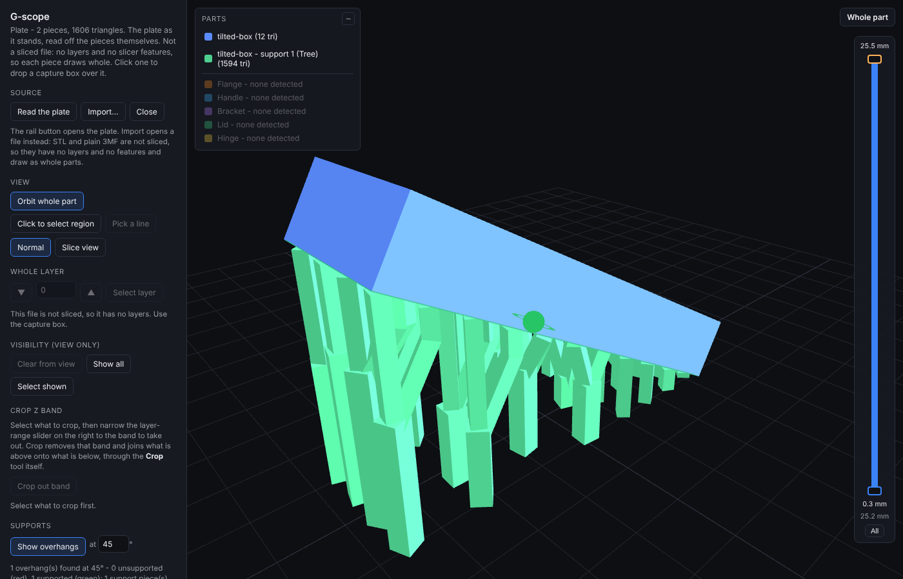

# Grid-pack supports — grown from the support points down to the plate

`nso_support_gridpack.js` (`window.NSO_SupportGridpack`, and a Node module).
Test: `npm run support:gridpack` (`tools/nso_support_gridpack_test.js`, in `npm test`).

It **replaces the trunk-first planner** (`planSolid` in `nso_support_tree.js`,
`docs/SUPPORT-TREE.md` §4–5). `NSO_SupportTree.planTree` keeps its name and its
callers and now returns this planner's plan. G-scope's three styles all use it:

| style | what changes |
|---|---|
| Straight strut | merge eagerness 0: one straight post per support point, never merged |
| Tree | merge eagerness 1: pairwise merges on the node lattice |
| Gecko-hand | the tree's plan exactly, plus a hand at every point |

What stays: the sweep (`nso_path_sweep.js`), the interface finish
(`nso_support_interface.js`, fed by `plan.stations`), hollowing (`hollowTree`,
now bores on this planner's members), the union (`unionParts` / `_finishUnion`)
and the 3MF object path. `NSO_SupportAim.nearestBase` / `aim` / `plan` also stay:
`nso_assemble.js` and their own suites use them. Only the support planner
stopped using them.

---

## 1. Why

The trunk-first planner planted one trunk under the contacts' centroid and
fanned branches up from one collar. One contact outside the fan's reach refused
the whole region:

- a flat face tilted 30° refused with *"widest branch leans 180° off vertical"*
  (contacts below the split);
- the straight strut built one post at the region's centre;
- a second Generate stacked a support inside the first.

Direction: **over-support by default, refuse only the impossible.**

## 2. The planner

Deterministic. Dials:

| dial | value | source |
|---|---|---|
| strut side `s` | `buildStrut`'s, 1.2 mm, never under `NSO_Thickness.floorFor` | existing strut law |
| point pitch `p` | `MAX_SPAN_MM` 3.29, widened for fat struts (below) | the beacon grid |
| lean limit θ | `BRANCH_TILT_DEG` 31.44° | the existing branch angle |
| node lattice `L` | 5 mm: nodes every L/2 = 2.5 mm in x, y and z (z from the plate) | the ticket; Bambu's own 2.5/5 lattice |

**Beacons.** `{ p, n }`: a point on the surface and its outward normal.
`opts.beacons` takes an explicit list (`{ p, n }` or a detector record
`{ x, y, z, normal }`, each with an optional `regionId` and `key`): the
Supports card's, `docs/SUPPORTS-CARD.md`. Every trunk then carries
`regionIds`, and every solid `beacons`, `regionIds` and `landing`.
`gridBeacons` is the adapter: `detectOverhangs`' regions gridded at `p` through
the tree's own `contactPoints` (centred lattice plus covering top-up), each
point carrying the normal of the triangle under it. `beaconsFor` is the one
place to swap in `NSO_SupportBeacons.detect` when `claude/support-beacons`
lands; `opts.beacons` takes a list directly.

**Level 0.** Every point starts a strut straight down. A *side* point (its face
leans more than θ off straight down) gets a horizontal stub of `s + 0.2 mm` out
along its normal first, then turns down.

**Descent.** Lattice levels are visited top down. A member hangs straight from
its *anchor* (its point, a merge node, a pickup point, the end of a steer). At
level `z` its lean budget is `(anchor.z − z)·tan θ·eagerness`.

**Merging.** Two free members whose budgets both reach the lattice node nearest
their midpoint lean to it in one straight leg each and become one member there.
Pairs go closest first, each member at most once per level. A merged member
carries its count: a square section of area `count × s²`, **capped at 4 × s²
(FLAG)**. **Square section (FLAG).** A node keeps its distance: the new column
and the legs into it must not touch another member, or two solids that touch
up top and meet again lower close a loop. A member in the way that can reach
the node joins (a merge of 3, never more); otherwise the merge waits a level.

**Column pickup.** A free member passing within one point pitch of a lower
point picks it up with a stub: a leg leaning θ, then a vertical last 2·s to the
point, so the tip meets the face the way a strut's does.

**Obstacles.** Every leg is tested before it is taken, with
`NSO_SupportAim`'s own rays: the axis plus 8 rails on the section's
circumscribed circle plus `CLEAR_MM` 0.2 (vertical ones through its down grid),
and `lineInsideAt` on each, because a rail starting inside a wall crosses no
face and reads clear. A blocked merge does not happen that level. A member
whose drop to the plate is blocked **steers**: for 16 headings at θ and θ/2 the
leaning line from its anchor is walked down the levels, one leg check and one
drop check per heading per level, no path search; the shallowest clear drop
wins. A drop clear through a hole in the piece is a clear drop, so openings are
found this way.

**The tip's zone.** The rail test leaves a tip's last cross-section out (on a
sloped face the cap's downhill corner meets the face by design). A side wall
there is different: the interface finish could not keep its gap (measured
0.07 mm and 0 mm on the tab and tall arms beside the post). So the tip's top
1.5 mm is swept with horizontal rays, ignoring the face being supported. A tip
in a wall is moved off it along the face's tangent plane, by ¼–1 × s, and the
move is reported in `plan.nudged`. A tip that cannot clear by the margin but
does not touch the wall stays (`plan.tight`).

**Landing.** Plate first, always.

- `restOnModel` off (default): a point with no plate route builds nothing and is
  counted *unreachable from the plate*.
- `restOnModel` on: it drops onto the piece and stands on a two-layer
  (0.4 mm) pad one support gap (0.18 mm) above the surface. It is counted
  *resting on the part*.

**Refusal.** Only a support point inside the piece (`lineInsideAt` along its
own normal). Beside good points it is left out and named. If every point is
inside, the plan refuses in one line: *"Every support point is inside the
piece, so there is nowhere to start a support."*

**Geometry.** Each member is one `NSO_PathSweep` of a constant square section
along its polyline, every bend a mitred joint. Each part's square is turned by
its own phase (golden angle × index, mod 90°), so no two parts share a wall
plane. A member formed at a node starts half its side above the node. Members
ending in a junction run on past it by a quarter of the member they join, so
no two leg ends share a vertex. Each landed trunk is folded through
`NSO_unionSoups` into one solid; trunks that touch are joined; the rest go side
by side in one soup. `opts.hollow` bores every member whose `side − 2·wall` is
at least the floor.

**Idempotent.** Every order is fixed, so the same input gives the same bytes.
G-scope's Generate on a region that already has supports replaces them as one
undo step.

## 3. Measured (`support:gridpack`, 80 checks)

*The tilted box generated through G-scope's own Generate (Tree, 1.2 mm):
"Holds 50 of 50 support points on 35 trunks to the plate". In the app the
piece sits at its plate position, so the lattice falls differently than in
the suite's frame (29 trunks).*

| fixture | result |
|---|---|
| **tilted box 30°** (40 × 12 × 6 on its edge) | 50 of 50 held, 29 trunks, all on the plate, no refusal; 10 pickups, 10 merges; worst leg 28.6°; mesh_validate clean, one shell per solid |
| **flat shelf, 3 × 3** | 4 first merges, each at the predicted level z 15.00 (pred 15.00), within 0.1 mm; then 1 trunk; every merge 2 members except one of 3 |
| **box with a through-hole** | 9 of 9 held; 8 points steered into the hole; the one trunk stands in it at [10, 10] and goes through the block to the plate |
| **mushroom on a wide stem**, rest OFF | 12 of 12 cap points *unreachable from the plate*, nothing built, no refusal |
| same, rest ON | 12 of 12 *resting on the part*, on the stem top (z 6), pad at 6.18 |
| **boss** | **28 of 28 held** (trunk-first: 24); 3 trunks, all to the plate; tips moved off the boss and post |
| **60 mm overhang** | 28 of 28 on **one trunk**, its section capped at 2.4 mm (4 × the strut area) |
| **Generate twice** | identical bytes (2,936 triangles on the boss) |
| strut style | no merges or pickups: 9 posts for 9 points |
| gecko-hand | the tree's plan exactly; mesh clean, no handles on the boss |
| point inside the piece | the one refusal, one plain line; beside a good point it is left out and counted |

Status lines are plain: *"Holds 28 of 28 support points on 1 trunk to the
plate."*, *"Holds 0 of 12 support points; 12 unreachable from the plate."*.

**On the reference** (`tree:reference`): the 70 mm tabletop's 484 points land on
81 trunks; Bambu's slice used 36. One reference trunk's 10.65 mm cell lands on 3.

## 4. Robustness sweep (not a suite; recorded here)

9 shapes × 3 styles × sizes 1.2, 2 and 3 mm, every output through mesh_validate:

- **Size 1.2 (default), tree and strut:** every case PASS, one shell per solid.
- **Sizes 2–3, tree and strut:** every case PASS (closed, manifold, no piercing).
  On tilted faces some neighbouring trunks fuse into loops (Euler below 2 per
  solid). A closed mesh, but a handle.
- **Gecko-hand:** default size PASS. On sloped faces at 1.2 and at Size 2–3,
  hands can still touch across trunks (handles). One case at Size 2 (shelf)
  leaves 2 grazing piercing pairs. **Known residual.** Gecko-hand is the shape
  option, and the handles are what `docs/SUPPORT-TREE.md` §5 measured for hands
  that reach too far.

Fixes the sweep forced, each measured:

- the point pitch widens with the strut, so a merged column clears the next row;
- the per-part square phase (a pickup stub's walls in its column's wall planes
  gave 4 non-manifold edges);
- a merge capped at 3 members (a 12-leg star on a 40° face was non-manifold);
- junction run-ons (shared leg ends pinched the union into 2 piercing pairs).

## 5. What changed elsewhere, and why

| file | change |
|---|---|
| `nso_support_tree.js` | `planSolid`, `splitPoint`, `clearWalls`, `probeRails`/`probeClear`/`clearFingers` and the root/split constants removed. They were the trunk-first planner. `planTree` delegates; `hollowTree` hands a grid-pack plan to its `solid({hollow})` |
| `app-gscope-support.js` | every style through `planTree` + `NSO_SupportGridpack.solid`; Generate replaces; an empty plan adds nothing and says why. No markup changed |
| `tree:test` | §2–5 asked about the split, the fan and the carried contact, which are gone; rewritten to ask the new planner the same things (every contact held, rails catch the window, gecko changes only tips) |
| `tree:canonical` | the parts are a trunk column and a strut; Euler is 2 per solid |
| `tree:round*` | the round/tapered parity was the old planner's; bores are now checked leg by leg on mitred members; the taper primitive is still pinned |
| `tree:interface` | stations come from the plan; `wallClearanceMm` gave way to the planner's own tip test |
| `tree:reference` | trunk count on the tabletop, and one cell's share, instead of `trunksNeeded` and the split height |
| `support:inside` | "refused at the base" was the old trunk; now no leg of any member runs inside the part |
| `gcode:gscope-support` | direct calls through the new planner; + "Generate again replaces" |
| `tools/nso_support_slice_artifact.js` | `--tree` ported |
| `tools/nso_curved_branch_probe.js` | historical: it measured the trunk-first planner and no longer runs against `planTree` |

## 6. Flags and out of scope

- **FLAG** square section everywhere; area cap 4 × s²; merges of up to 3.
- **FLAG** pickup reach = 1.05 × the pitch; the stub's vertical last run is 2 × s.
- **FLAG** resting pad: 0.4 mm, a 0.18 mm gap above the surface (a floating
  first layer, as slicers print support-on-model).
- Hollowing bores only merged members at the default size: a single 1.2 mm
  strut would leave 0.36 mm, which no slicer keeps.
- Ray tests on leaning legs are brute force. Steering is cheap on these
  fixtures (the suite runs in about 35 s); a 30k-triangle part wants the 3D
  index `docs/CURVED-BRANCH.md` §2b names.
- Out of scope, as asked: economics dials beyond L, curved legs, UI, GRISPR.

## Paint scope: sub-region — inherited

Points come from `detectOverhangs` with `opts.skipList` passed through, as the
tree did. This file names no faces of its own.
