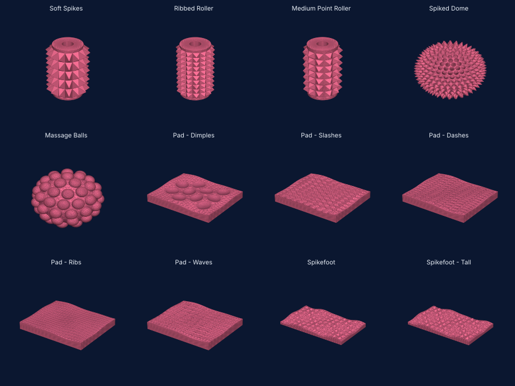

# Wrap - one feature, laid over a face

Take **one** feature - a ball, a spike or pyramid, a bump, a dent, a line - and lay it over a face as
many times as the spacing asks: a flat face, a **cylinder**'s side, a **tube**'s bore, a **sphere** or
dome, or a **contoured** face (a foot's sole, a pad, any surface a view along its normal can see whole).
**Height**, **depth**, **spacing** and **density** are numbers; there is a skin for **every design** on
the two plates this was built from. The engine is `nso_surftex.js` over `nso_cdt.js` and `nso_weave.js`
(THREE-free, node-tested: `npm run surftex:test`); the presets are `nso_surftex_presets.js`; the card is
`app-surftex.js` (**Surface & edges -> Wrap**; `npm run surftex:drive`).

Samples: `fixtures/surftex/*.stl` - each design skin wrapped on a bare primitive of its own kind (a 95 mm
tube, a sphere of R 22.5, a contoured slab). They are what the tool makes, not the originals.

## The card

The card is **live** (`app-surftex-live.js`). **Feature** and **Layout** are shelves of tiles - each picture is the engine's own wrap on a small
flat slab with the new surface lit green - and while the card is open the piece shows the wrap as a ghost: touch a tile, a skin, a number or the face
and the new patch is drawn on the piece, redrawn as the numbers move (a click on the piece picks the face under it). **WRAP** installs the result that is
on screen, bit for bit; Close drops it. A redraw waits as long as the last one took, and one that took more than 2 s is redrawn when a number is let go
rather than at every key. The Feature and Layout `<select>`s are still in the page, hidden, and hold the values the card reads and the skins write.

1. **Face.** The piece is cut into smooth faces - neighbouring triangles turned less than **Crease**
   (30 degrees) are one face - and each is fitted: a flat face, a cylinder (`Cylinder Ø40`) or a bore
   (`Bore Ø15`), a sphere (`Sphere R22.5`), or a contoured face. The one picked is tinted amber on the
   piece; **All of the above** wraps every face listed (the biggest twelve) in one go.
2. **Skin.** A preset (below) fills the numbers; or set the feature by hand.
3. **WRAP.** The face is replaced by a new patch. One Undo puts the piece back.

| number | means |
|---|---|
| **Feature** | spike (a cone, or an n-sided pyramid: Sides 3 to 8, 4 is square), ball, bump, dent, line |
| **Size** / **Length** | the footprint, mm: a round feature's diameter, a pyramid's side, a line's width and length. Length is the footprint along the row (blank: as Size; a line: the row pitch, so lines run end to end) |
| **Height** | how far a ball, spike, bump or ridge stands off the face. A ball is at most a hemisphere (height <= size / 2) |
| **Depth** | how far a dent or a groove goes into the face |
| **Tip** | a round spike's profile: 1 straight, below 1 blunt (a soft tip), above 1 a needle |
| **Spacing** / **Rows** | centre to centre across, and between rows, mm |
| **Density** | features per cm². Above 0 it sets the spacing (and the row pitch) |
| **Layout** | grid; stagger (every other row half a pitch over); hex (stagger with equilateral rows); diamond (a rotated grid) |
| **Rotate** / **Lattice** | turns each feature about the face's normal / turns the whole lattice (flat and contoured faces; a cylinder's columns follow its axis) |
| **Margin** | how far a feature stays clear of the face's edge |
| line: **Section**, **Groove** | V, round or flat-topped; a ridge or a groove cut in |

Fields that mean nothing for the feature chosen are hidden (a dent has Depth and no Height).

## The skins

Each skin is a set of the numbers above, read off the design it is named for, and can be wrapped on any
kind of face. `measured` is what the design had.

| skin | from | measured | faces |
|---|---|---|---|
| **Soft Spikes** | the Soft Spikes roller | 14 round, 5 rows, 9.0 x 17 mm cells, 9.0 mm tall; wide teeth that fill their cell | cylinder, tube |
| **Ribbed Roller** | Ribbed Roller | 14 round, 10 rows 8.6 mm apart, 5.35 mm tall | cylinder, tube |
| **Medium Point Roller** | Medium Point Roller | 11 round at 11.7 mm, rows 12 mm apart, 6.1 mm tall | cylinder, tube |
| **Spiked Dome** | "1.0" | R 22.5, spikes 4.0 mm apart, 3.5 mm tall | sphere, dome |
| **Massage Balls** | the ball dome | 32 balls, about 10.5 mm apart, standing 4.6 mm | sphere, dome |
| **Pad - Dimples** | 66.stl_5, _8 | round dimples about 11 mm across, 14 mm apart | contoured, flat, dome |
| **Pad - Slashes** | 66.stl_7, _10 | diagonal grooves, 4.5 mm apart | contoured, flat, dome |
| **Pad - Dashes** | 66.stl_9 | short slots 1.6 x 5 mm | contoured, flat, dome |
| **Pad - Ribs** | 66.stl_11 | long ridges 3.2 mm apart | contoured, flat, dome |
| **Pad - Waves** | 66.stl_13 (nearest) | ridges 5 mm apart | contoured, flat, dome |
| **Spikefoot** / **Spikefoot - Tall** | spikefoot (left12) | square pyramids 4.95 mm a side on an 8.0 mm grid, 3.43 mm (4.33 on the tall ones) | contoured, flat |
| Ball, Spike, Pyramid, Bump, Dent, Line | - | one feature, to start from | any |

On a bare roller of the design's size (a 95 mm tube, Ø40 over a Ø15 bore) **Soft Spikes** makes 70 teeth
reaching 29.00 mm from the axis and **Ribbed Roller** 140 reaching 25.35 mm - the designs' own counts and
reach (the gates `6a`).

**Not a single feature repeated, so not skins:** the pads' nested ovals (`66.stl_4`, `_6`) and swirl
(`_12`). `Pad - Waves` is the nearest the five features come to `_13`'s wave.

## How it works

A wrap is a **motif**, a **lattice** and a **face**. Nothing about it depends on which face.

1. **The face is fitted**, and the fit says how to unroll it - a *chart*, a map from the face to the
   plane, and its inverse, the *lift*:
   - plane: the identity; cylinder / bore: unrolled (x = arc length, y = along the axis), periodic when it
     wraps; sphere: stereographic about the pole (a circle on the sphere is a circle in the chart, so a
     Delaunay triangulation of the chart is the Delaunay triangulation on the sphere); contoured: a view
     along its mean normal, the height and the normal read off the face itself (a face that folds over
     itself along that view - more than 2% of it steeper than 78 degrees - is refused in words).
2. **Tile centres come off the lattice.** On a cylinder the column count is made a whole number (the
   pitch is snapped, and the readout says so), so the wrap closes; on a sphere the rows are latitude rings
   from the pole with as many tiles as fit; on a flat or contoured face the lattice is centred in the face
   and tried at the four half-pitch phases for the one that puts the most whole features on it. A tile
   that does not fit whole inside the face, `Margin` clear of its edge, is left out.
3. **Footprints never overlap.** If the size asked is more than the spacing allows, every footprint is
   shrunk together - a bisection over a separating-axis test in each tile's own tangent plane - until they
   touch, and the readout says what it did. On a sphere or a contoured face, where every tile has its own
   tangent frame, features that touch are held 2% apart.
4. **Each tile brings its own points** - the apex, the footprint's corners, the rings between - exactly
   what the feature is made of, and its footprint edges and ridge lines as **forced edges**. The rest of the
   face is filled with a coarse hex of points, fine enough that a chord never strays more than about
   0.03 mm from a curved face, and kept out of every footprint (judged in 3D: a chart can stretch).
5. **One constrained Delaunay triangulation** (`nso_cdt.js`, which gained an option for forced edges that
   are *not* outline) of all of it, the face's rim edges as the outline. The new patch meets the old mesh
   at the rim corner for corner: no weld, no boolean, nothing to repair. On a cylinder the strip is
   triangulated over five periods and each triangle is kept in the one copy where its lowest-numbered
   corner stands in the middle period, so the seam is exactly closed.
6. **Every point is lifted** back onto the face and moved along the face's normal by its height (plus for
   a ball, a spike, a ridge; minus for a dent, a groove). Rim points do not move: they are the mesh's own
   coordinates, bit for bit.

The patch replaces the face's triangles; everything else in the piece is copied as it was.

### What a bore does

A bore's outward normal (out of the material) points at the axis, so a spike in a bore points at the axis
and a dent goes into the wall. A tube is two faces, its outside and its bore; **All of the above** wraps both.

### A closed sphere

A sphere with no outline has nothing to hold at, so the bottom 14 degrees are left plain and used as the
outline. (A dome - a cap with its own rim - wraps all the way.)

## What it refuses (in words)

- no feature fits whole inside the face (clear of its edge by the margin) - a smaller size, spacing or margin
- more features than the tool will lay (40,000) or points than it will triangulate - raise the spacing or lower the density
- the face folds over itself along its own normal - try a smaller crease angle, or wrap a flatter part
- a face with a self-crossing outline, or one the chart cannot cover
- paint: any painted face stands Wrap down, naming the count (the whole-piece paint scope - a new patch
  renumbers the triangles the paint names; `docs/HANDOFF.md`)

## Limits, stated

- A ball is at most a hemisphere (a heightfield on the face: no undercut). Pyramids and cones are cut
  from straight-edged polygons: a round foot is a 16 to 40-gon, so a round feature's volume is 3 to 6%
  under the exact cone or cap (gates `1`).
- Spacing on a contoured face is laid in the view's plane, so on a slope it is wider along the slope
  (1 / cos of the lean); sizes are true. A steep dome is better wrapped as a sphere, where the rows are
  rings on the surface.
- The pads' nested rings and swirls are not a lattice of one feature.
- Features are not clipped at the face's edge: whole features only, `Margin` clear.

## Tests

`npm run surftex:test` - 101 gates: the fixtures are closed; every feature x grid / hex on a flat face
(closed by the app's own checker, the volume is the features' own: pyramids to 3%, round features to 9%);
cylinder (a whole number of columns, spikes reach R + height to 1 micron, a cylinder lying on its side or
tipped wraps the same); tube (outside outward, bore inward, a dent into the wall, both at once); sphere
(R + height, the far pole plain); contoured (tips stand their height over the face); every skin on its own
kind of face and six of them on a kind that is not theirs; spacing, density, height, depth, size,
rotation, lattice angle, layouts, 3 / 6-sided pyramids, ridges and grooves; the rim held bit for bit, the
input untouched, all six faces of a box at once; the refusals.

`npm run surftex:live` - the live card in real Chromium: nine tiles painted from the engine, each a different picture; a tile ghosts the piece and draws
the patch; a number, a skin, a layout and the Face list move it; a click on the piece picks its face; WRAP installs the previewed soup bit for bit with
one Undo; Close and a refusal leave the piece untouched.

`npm run surftex:drive` - the card in real Chromium: loaded, wired, Face lists the fitted faces, a skin
fills the numbers, the feature hides and shows fields, WRAP (status, triangle count, reach from the axis),
the highlight, Undo, a refusal.
